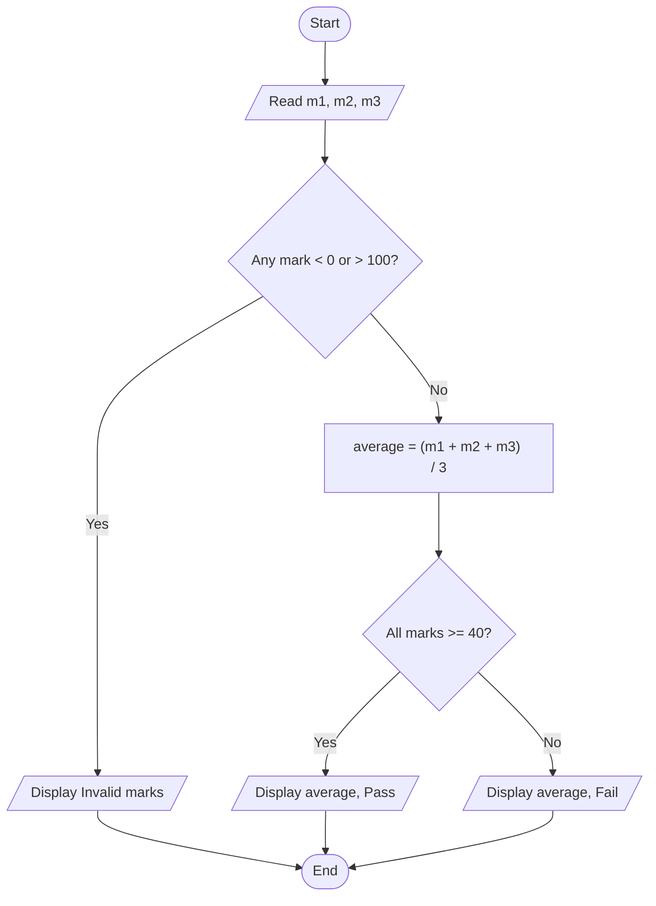
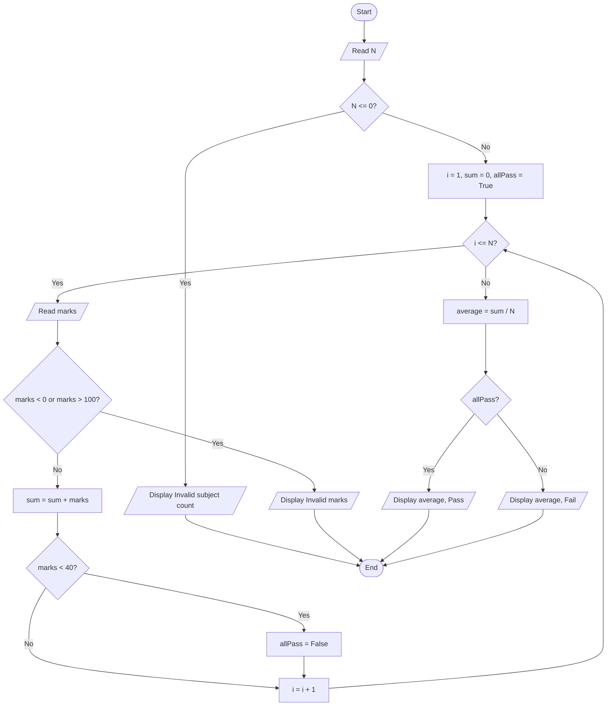

# DSA basics 
## Notes from day 1.

DSA is language independent.  
DSA is about learning concepts, observing patterns and solving problems. Once you have a solution all you need to do is express it. That can be done using any programming language.
  > [!IMPORTANT]
  > If you cannot solve the problem you cannot express it. 


# programming and what are computers.

## What is programming?  
Programming is the act of creating precise, ordered instructions for a computer to carry out a task.  

## What is a computer?
A computer is a machine that follows instructions. it can execute enormous numbers of stored instructions at a speed that would be impractical for a person performing the same operations manually.

**Hardware** means physical components. Examples include the screen, keyboard,mouse, CPU ,memory chips, battery, camera,storage devices and wires

**Software** means programs and related information. Examples include a browser, calculator, games ,YouTube and operating systems such as macOS, windows, Android.

## How storage, the operating system, RAM and the CPU work together?
- Storage:
    - Storage keeps installed application files, saved photos, videos and other data. 
    - Saved data remains there where the power is switched off. This is called persistent storage. 

- Operating System:
    - The operating system manages applications and hardware resources.

- RAM(Random access memory):
    - RAM is the computer's fast, temporary working memory.it holds instructions and data currently needed by running programs.

> [!IMPORTANT]
  >  A **program** is a set of instructions that tells a computer what to do. Programming is the activity of creating those instructions; a program is what you create.  
  > A **bug** is a defect that causes wrong or unexpected behaviour.  
  > **Debugging** is a process of finding and fixing the cause of a defect, then checking that the fix works.

## Why programming languages exist
At a low level, a processor executes machine instructions represented using bits, whose values are 0 and 1.  
 Data is also represented using bits. A sequence of binary digits is therefore not automatically a machine instruction; its meaning depends on how it is interpreted.

## How to think like a programmer

### Steps to solve any problem
1. Understand the problem (input, output, rules)
2. Break it into smaller steps
3. Write the steps in order
4. Test with a small example
5. Fix mistakes and improve

> [!IMPORTANT]
> **Think first, code later.**

## Flowcharts and pseudocode

### Flowchart
A flowchart is a diagram that represents the operations, decisions and repeated steps in a process.

### Pseudocode
A flowchart expresses an algorithm through shapes and arrows. Pseudocode expresses an algorithm through readable, structured instructions, without requiring the exact syntax of a programming language.

### Example
```
READ age

IF age >= 18 THEN
    DISPLAY "Eligible"
ELSE
    DISPLAY "Not eligible"
END IF
```

> [!IMPORTANT]
> **Plan the logic first, then write the code.**

# Flowchart Problem-solving lab

## Follow the same cycle each time:
Understand → Model → Draw → Dry-run → Challenge → Express as pseudocode

## Flowchart problem: student result with a subject-wise rule

### Requirement
Read marks in three subjects. Marks must lie from 0 to 100.

- If any input is outside that range, display "Invalid marks".
- Otherwise, display the average and report **Pass** only when every subject has at least 40 marks.

### Decompose the problem
1. Validate all inputs.
2. If valid, calculate the average.
3. Check the subject-wise pass rule.
4. Display the result.

> [!IMPORTANT]
> **Validate first.** For marks `90, 105, 80`, the average is a number, but it has no valid meaning because 105 is outside the allowed range.

### Flowchart



### Dry runs

| Case | Marks | Valid? | Average | Result |
|------|-------|--------|---------|--------|
| A | 70, 80, 90 | Yes | 80 | Pass |
| B | 90, 90, 30 | Yes | 70 | Fail (one subject below 40) |
| C | 90, 105, 80 | No | not calculated | Invalid marks |

### Pseudocode

```text
READ m1, m2, m3
IF m1 < 0 OR m1 > 100 OR
   m2 < 0 OR m2 > 100 OR
   m3 < 0 OR m3 > 100
    DISPLAY "Invalid marks"
    STOP
END IF
SET average = (m1 + m2 + m3) / 3
IF m1 >= 40 AND m2 >= 40 AND m3 >= 40
    DISPLAY average, "Pass"
ELSE
    DISPLAY average, "Fail"
END IF
```

> [!IMPORTANT]
> **Key idea:** Validation asks whether the data is allowed. Business logic asks what the valid data means. Keep those two questions separate.

## Flowchart problem: extend the same rule to N subjects

### Requirement
Generalize the three-subject problem to `N` marks.

- Read a positive integer `N`. Reject `N <= 0` before doing anything else, because the average would be undefined or the count invalid.
- Check each mark for validity **before** it is added to the running sum.
- Report **Pass** only if every subject has at least 40 marks.

### State to track
| Variable | Starts as | Purpose |
|----------|-----------|---------|
| `i` | 1 | Counts which subject we are on |
| `sum` | 0 | Running total of marks |
| `allPass` | True | Becomes False if any mark is below 40 |

> [!IMPORTANT]
> **Never reset `allPass` back to True.** One failed subject is enough to fail the subject-wise rule, so a later passing mark must not undo it.

### Flowchart



### Pseudocode

```text
READ N
IF N <= 0
    DISPLAY "Invalid subject count"
    STOP
END IF
SET i = 1
SET sum = 0
SET allPass = True
WHILE i <= N
    READ marks
    IF marks < 0 OR marks > 100
        DISPLAY "Invalid marks"
        STOP
    END IF
    SET sum = sum + marks
    IF marks < 40
        SET allPass = False
    END IF
    SET i = i + 1
END WHILE
SET average = sum / N
IF allPass
    DISPLAY average, "Pass"
ELSE
    DISPLAY average, "Fail"
END IF
```

### Dry run: N = 3, marks 60, 70, 30

| Step | i | marks | sum | allPass |
|------|---|-------|-----|---------|
| Start | 1 | - | 0 | True |
| Subject 1 | 1 | 60 | 60 | True |
| Subject 2 | 2 | 70 | 130 | True |
| Subject 3 | 3 | 30 | 160 | False |
| Loop ends | 4 | - | 160 | False |

Average = 160 / 3 ≈ 53.33, and `allPass` is False, so the result is **Fail**.

### Other cases

| Input | Result |
|-------|--------|
| N = 3, marks 60, 70, -14 | Invalid marks (stops, no average shown) |
| N = 0 | Invalid subject count |

### Key ideas
- **Divide by `N`, not a fixed 3.**
- Validate the count first, then validate each mark inside the loop.
- A flag variable (`allPass`) remembers a fact across the whole loop.
- Assumption: marks are numeric and `N` is an integer. Handling non-numeric text is outside this lab.  